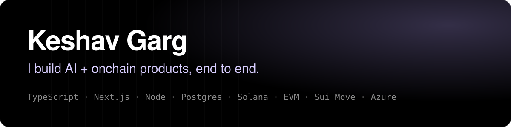

I build products end to end: the frontend, the backend, the onchain parts and the infra they run on. Right now I'm building **Mooshies**, an AI agent for web3 traders.

### What I've built

| Project | What it is | Built with |
| --- | --- | --- |
| **[Mooshies](https://mooshies.family)** | An AI companion for traders. You sign in with X and link your wallets; it reads every trade into a ledger, answers questions in chat with receipts, watches the market and sends alerts. 800+ commits in 7 weeks across 4 apps and 6 shared packages. | Next.js 16 · Fastify · Postgres + Prisma · pg-boss · Azure OpenAI · Privy · Solana + EVM |
| **[Mentara](https://github.com/keshav2800/mentara)** | A bonding-curve launch protocol and SDK for Sui. Launch a real coin, trade it on a curve, graduate it to an AMM at the exact final price, and split every fee between protocol, launchpad and creator. | Sui Move · TypeScript SDK |

### How I build

- **Money is integers, never floats.** Every balance change is written with its ledger row in one transaction, so any number can be traced back.
- **Validate once at the edge.** Then trust the types and let the database enforce the rules.
- **Ship small, then grow.** The smallest useful version goes out first; real usage decides what comes next.

### Open source

<!-- OPEN-SOURCE:START -->
**Merged**

- [Add Taraxa chain for evm](https://github.com/chainapsis/keplr-chain-registry/pull/1172) · `chainapsis/keplr-chain-registry`

**In review**

- [fix(test): import Role from its current location in admin e2e spec](https://github.com/Stellar-Uzima/Uzima-Backend/pull/1760) · `Stellar-Uzima/Uzima-Backend`
<!-- OPEN-SOURCE:END -->

### Reach me

X [@keshavlabs](https://x.com/keshavlabs)
